  

I’m working on **AI-native development workflows for production software**. I want to use agents in codebases I have to maintain, with code review and tests I can rely on.

Much of that work comes down to giving agents the right project context and checking their changes. I’m experimenting with how to make both part of my development process, from the first task through CI and deployment.

I like architecture that’s boring to maintain and hard to break.

  

